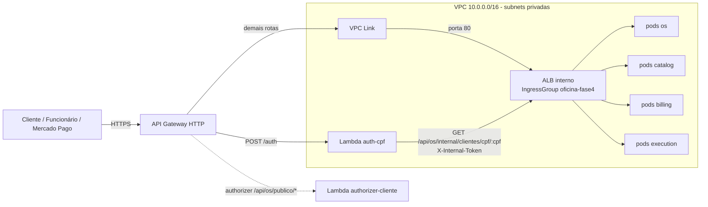

# tc-fase4-infra

Infraestrutura compartilhada do Tech Challenge — Fase 4 (FIAP Pós Arquitetura de Software):
**VPC** (3 AZs, NAT único), **EKS** (3 nodes `t3.medium`, IRSA, access entries para as
esteiras dos 4 serviços), **AWS Load Balancer Controller**, **Grafana Alloy** (opcional),
**ECR** (um repositório por serviço), **segredos compartilhados** no Secrets Manager e o
**API Gateway HTTP** (stack `gateway/`), única entrada pública da aplicação.

Terraform ≥ 1.10, state remoto em S3 (`tc-fase4-tfstate-538880133939`, lock nativo
`use_lockfile`). Cópia evoluída de `tc-infra-kubernetes` da Fase 3.

## Arquitetura



O ALB **não é exposto na internet** (`scheme: internal`). O gateway chega a ele por um
**VPC Link** (ENIs nas subnets privadas), e a Lambda de auth, que roda na VPC, chama o ALB
direto.

## Rotas do gateway

| Rota | Alvo | Autorização |
|---|---|---|
| `POST /auth` | Lambda `oficina-fase4-auth-cpf` | nenhuma |
| `ANY /api/os/publico/{proxy+}` | ALB | authorizer `cliente-jwt` (JWT `perfil = CLIENTE`) |
| `ANY /api/os/internal/{proxy+}` | ALB | `AWS_IAM` — quem vem de fora recebe **403** |
| `ANY /{proxy+}` | ALB | nenhuma no gateway (cada serviço valida o JWT de funcionário) |

`/api/billing/publico/*` (link do e-mail, token na query) e `/api/billing/webhooks/*`
(assinatura do Mercado Pago) caem no catch-all, sem authorizer.

**Uma integração só.** Na integração privada (VPC Link → listener do ALB) o API Gateway
repassa o caminho original da requisição, então todas as rotas usam a mesma integração. Na
Fase 3 a integração era HTTP pública com URI `http://<alb>/.../{proxy}`, e o `{proxy}` vinha
sem o prefixo da rota, por isso eram duas integrações. A integração também define
`overwrite:path = $request.path`, como a documentação da AWS indica para evitar que o nome de
um stage seja prefixado ao caminho (aqui o stage é `$default`).

Outputs do gateway: `api_endpoint`, `public_base_url` (vai no `PUBLIC_BASE_URL` do Billing) e
`webhook_url` (`<api>/api/billing/webhooks/mercadopago?source_news=webhooks`, vai no
`MP_NOTIFICATION_URL`).

## Contrato para os serviços

Cada serviço publica o próprio Ingress no CD (Etapa 8). Nada de Ingress neste repo. Todos
precisam das mesmas anotações para cair no mesmo ALB interno:

```yaml
metadata:
  annotations:
    alb.ingress.kubernetes.io/scheme: internal
    alb.ingress.kubernetes.io/group.name: oficina-fase4
    alb.ingress.kubernetes.io/target-type: ip
    alb.ingress.kubernetes.io/security-groups: <output alb_security_group_id>
    alb.ingress.kubernetes.io/manage-backend-security-group-rules: "true"
spec:
  ingressClassName: alb
```

O SG do ALB é gerenciado aqui (`alb.tf`), e não pelo controller, para que a Lambda
(`tc-fase4-auth`) e o VPC Link (`gateway/`) adicionem as suas regras de entrada de forma
declarativa. Por isso as regras desse SG são recursos separados: blocos inline apagariam as
regras das outras stacks a cada apply. Com `manage-backend-security-group-rules`, o
controller libera o tráfego ALB → pods no SG dos nodes.

Outputs da stack raiz usados por outros repos (via `terraform_remote_state`, key
`infra/terraform.tfstate`): `vpc_id`, `vpc_cidr`, `private_subnets`,
`node_security_group_id`, `cluster_name`, `cluster_endpoint`, `oidc_provider_arn`,
`ecr_repository_urls`, `jwt_secret_name`/`_arn`, `internal_token_secret_name`/`_arn`,
`ingress_group_name`, `alb_security_group_id`.

## Segredos

| Segredo | Uso |
|---|---|
| `oficina-fase4/JWT_SECRET` | assina e valida os JWT HS256 (funcionários e clientes) em todos os serviços e na Lambda |
| `oficina-fase4/INTERNAL_SERVICE_TOKEN` | header `X-Internal-Token` da rota interna do OS, usada pela Lambda |

Gerados por `random_password` (48 caracteres, sem especiais) e gravados no Secrets Manager
com `recovery_window_in_days = 0`, para o destroy/recriar dos ensaios não travar no nome.
**O valor fica no state do Terraform**, que está em bucket S3 privado, versionado e
criptografado. Nenhum valor é versionado neste repo. Os segredos de cada serviço
(`DATABASE_URL`, `MP_*`) ficam no Terraform de cada serviço.

## ECR

`oficina-fase4-os`, `oficina-fase4-catalog`, `oficina-fase4-billing` e
`oficina-fase4-execution`: tags imutáveis, scan on push, lifecycle mantendo as 10 imagens
mais recentes e `force_delete` (ambiente de estudo).

## Ordem de subida (descida = inversa)

1. `tc-fase4-infra` (esta stack raiz: VPC, EKS, addons, ECR, segredos, Alloy)
2. Terraform de catalog, billing e execution
3. Terraform do os (assina os tópicos)
4. CD dos 4 serviços (os Ingress criam o ALB interno)
5. `tc-fase4-auth` (precisa do ALB e do SG dele)
6. `tc-fase4-infra/gateway` (precisa do ALB e das Lambdas)

Na descida: `gateway` → `auth` → **remover os Ingress dos serviços** (o controller apaga o
ALB, os target groups e os SGs dele) → Terraform dos serviços → stack raiz. O destroy da raiz
tem um passo de limpeza que remove ALB, target groups e SGs que sobrarem com a tag
`elbv2.k8s.aws/cluster=oficina-fase4`, mas ele é rede de segurança: com os Ingress ainda no
cluster, o controller recria o ALB.

## Esteira (CI/CD)

| Workflow | Evento | Ação |
|---|---|---|
| `Terraform` (raiz) | PR / push na `main` | job `ci`: `fmt -check -recursive`, `init`, `validate`, `plan` (resumo no summary) |
| `Terraform` (raiz) | Actions → Run workflow | job `deploy`: `plan` \| `apply` \| `destroy`, com aprovação no environment `aws-infra` |
| `Terraform Gateway` | PR / push na `main` em `gateway/**` | job `ci`: `fmt`, `init -backend=false`, `validate` (o plan depende do ALB e da auth) |
| `Terraform Gateway` | Actions → Run workflow | job `deploy`: `plan` \| `apply` \| `destroy`, com aprovação no environment `aws-infra` |

Autenticação via **OIDC** (role `gha-tc-fase4-infra`), sem access key no repo. **Merge na
`main` não faz apply**: subir a infra é sempre um `workflow_dispatch` aprovado.

Observabilidade: o Alloy (chart `k8s-monitoring`) só é instalado quando os secrets
`GRAFANA_CLOUD_OTLP_ENDPOINT`, `GRAFANA_CLOUD_INSTANCE_ID` e `GRAFANA_CLOUD_TOKEN` existem no
repo. Sem eles, `plan` e `apply` funcionam e a observabilidade fica desligada.

## Como rodar

- **Plan:** abrir PR (automático) ou Actions → Terraform → Run workflow → `plan`.
- **Subir:** Actions → Terraform → `apply` (~20 min). Depois dos serviços e da auth,
  Actions → Terraform Gateway → `apply`.
- **Derrubar:** Terraform Gateway → `destroy`, auth, remover Ingress, serviços, e por fim
  Terraform → `destroy` (~15 min).
- **Local (fallback):** `terraform init && terraform plan` com `AWS_PROFILE` válido. Para
  apply local, desligue `enable_cluster_creator_admin_permissions` se o seu usuário já estiver
  em `cluster_admin_principal_arns`, senão o EKS recusa a access entry duplicada.

## Custo

~US$ 8–9/dia com tudo no ar (EKS, 3 nodes, NAT, ALB, 3 RDS dos serviços). A infra só sobe
em janelas de teste e no dia da gravação.

## Versões

- **EKS 1.34**, mantida da Fase 3: em standard support até 01/12/2026, segundo
  `aws eks describe-cluster-versions` em 17/10/2026 (a versão padrão atual é a 1.36). Cobre o
  prazo da entrega; para usar o cluster depois de dezembro, subir `cluster_version`.
- **VPC Link v2 em us-east-1** não atende a AZ `use1-az3`. Nesta conta as 3 primeiras AZs
  (`us-east-1a/b/c`) são `use1-az6`, `use1-az1` e `use1-az2`, todas atendidas.

## O que mudou em relação à Fase 3

- ALB **interno** único por IngressGroup (antes: ALB internet-facing de um Ingress só) e
  gateway com **VPC Link** (antes: integração HTTP pública no DNS do ALB).
- Uma integração do gateway no lugar de duas; rota `/api/os/internal/*` bloqueada com
  `AWS_IAM`; authorizer em `/api/os/publico/*` (antes `/api/publico/*`).
- 3 nodes (antes 2); access entries para as 4 esteiras de serviço (antes uma só).
- 4 repositórios ECR com lifecycle (antes um só, sem lifecycle).
- `JWT_SECRET` e `INTERNAL_SERVICE_TOKEN` gerados aqui (novo).
- SG do ALB gerenciado pelo Terraform (novo).
- Sem apply no push para a `main`; apply/destroy só por `workflow_dispatch`.
- Limpeza do destroy por tag do cluster, e não pelo prefixo do nome do ALB.

## Repositórios relacionados

- [tc-fase4-os](https://github.com/Os-Desacoplados-Pos-Tech-SOAP-FIAP/tc-fase4-os) — atendimento e orquestrador da saga
- [tc-fase4-catalog](https://github.com/Os-Desacoplados-Pos-Tech-SOAP-FIAP/tc-fase4-catalog) — catálogo e estoque
- [tc-fase4-billing](https://github.com/Os-Desacoplados-Pos-Tech-SOAP-FIAP/tc-fase4-billing) — orçamento e pagamento
- [tc-fase4-execution](https://github.com/Os-Desacoplados-Pos-Tech-SOAP-FIAP/tc-fase4-execution) — fila, diagnóstico e reparo
- [tc-fase4-auth](https://github.com/Os-Desacoplados-Pos-Tech-SOAP-FIAP/tc-fase4-auth) — autenticação por CPF
